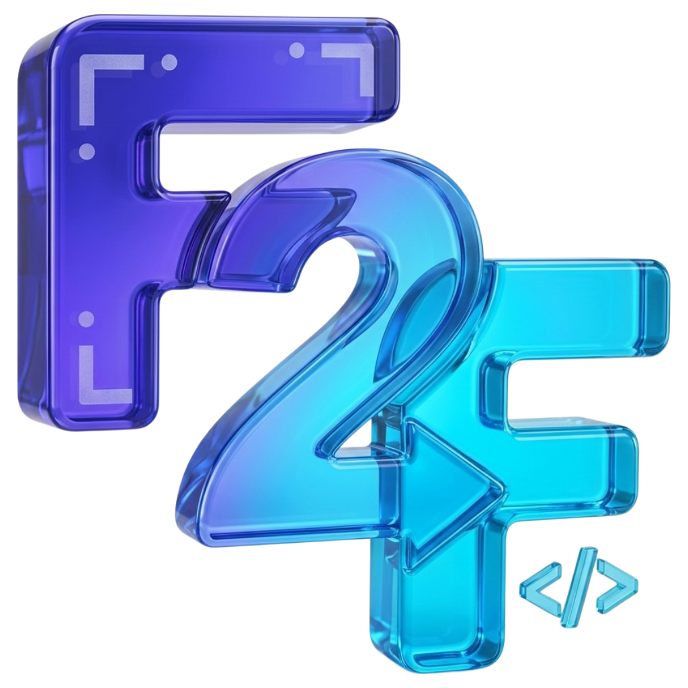

<p align="center"></p>

# F2F

A free, open-source (MIT), local-first tool that turns a Figma design into a portable `f2f/` package for any AI coding agent. It maps the design to your existing codebase and then **measures** the built screen against the design.

```
Figma plugin ──► f2f/ ─────────────► f2f build ─────────► agent implements ──► f2f verify ─────────────────────► fix ──► PASS
(exact values)   (JSON + outlines)    (repo-aware brief)    (any agent)          (web / Android / iOS / Flutter)
```

There is no server, paid API, MCP or telemetry. Your design data stays on your machine. The tool does not claim pixel-perfect output; it measures. Measured results are in [docs/benchmark.md](docs/benchmark.md).

**New here?** Start with [docs/getting-started.md](docs/getting-started.md). It covers setup, the full Figma → agent → verify loop and how to read the differences.

## Install

You need Node 22 or newer, plus Chrome or Edge for web verification.

1. CLI: `npm install -g f2f-cli` (the package is `f2f-cli`, the command is `f2f`; do not install the unrelated `f2f` package).
2. Figma plugin: open [F2F on Figma Community](https://www.figma.com/community/plugin/1691251414681348956) and run it once.

## How to use it

Follow [docs/getting-started.md](docs/getting-started.md) (also the website's /docs page). It has every step and the copy-paste prompts. In short:

1. **Export** your screens with the plugin and unzip the ZIP into your app root, so `your-app/f2f/` exists. Run `f2f validate f2f`.
2. **Describe your project once** in `f2f-project.md` (stack, UI library, folders, scope). Prompt 0 lets your agent draft it.
3. **Design system first:** prompt 1 builds the tokens and shared components.
4. **Build pages:** `f2f build --feature "<page or section name>" --repo .` writes a brief (several pages: `--feature "Page A, Page B" --name "My Pages"`), then prompt 2 builds them.
5. **Verify:** `f2f verify --screen <id> --url http://localhost:3000/<route>` (the brief has the exact command). Prompt 3 fixes what it reports.

## What verify checks

Tag each built element with its Figma id (the `#…` in the outline); the brief shows the snippet for your framework.

| Platform | Tag | Run |
|---|---|---|
| Web (React, Next, Vue, Svelte, HTML) | `data-figma-id="<id>"` | `f2f verify --screen <id> --url http://localhost:3000/route` |
| Flutter web | `Semantics(identifier: 'figma:<id>')` (helper in `packages/cli/templates/flutter/`) | `flutter run -d chrome --dart-define=FIGMA_VERIFY=true`, then `--url …` |
| Android (Flutter, React Native, Compose) | Flutter identifier / `testID` / `testTag` | app running on an emulator or device, then `--android` (uses `adb`) |
| iOS (Flutter, React Native, SwiftUI) | identifier / `testID` / `accessibilityIdentifier` | simulator, then `--ios` (needs [idb](https://fbidb.io)) |
| Flutter without a device | same `Semantics` tags | copy `packages/cli/templates/flutter/f2f_probe.dart` to `test/`, run `flutter test`, then `--measurements build/f2f/<id>.json` (bundle your fonts as assets) |

The report in `f2f/verification/<screen>.md` gives PASS/FAIL with:

- **Geometry:** every layer off by more than ±1 px, with Δx Δy Δw Δh, largest first.
- **Style (web):** computed font family, weight, italic, size, text colour, background and corner radius against the Figma values, plus fonts the browser fakes because their file is not loaded.
- **Small screen (web):** no sideways scrolling or cut-off content at 375 px.
- **Code rules:** no computed Figma ids, no raw two-decimal sizes or spacing copied from Figma.
- **Overflow, coverage, small differences** (text 1.5-4 px off or drawn at another width), and on web a diff image as a visual hint.
- **A fix prompt per screen** (`f2f/verification/<screen>.prompt.md`, with a copy button in the report) to paste into any coding agent.

## Other commands

| Command | What it does |
|---|---|
| `f2f inspect --repo .` | Show what the tool detects in a repo |
| `f2f refresh --package f2f` | Regenerate the outlines with a newer tool version (no re-export) |
| `f2f bench --package f2f [--repo . --feature x]` | Measure size, tokens, time and memory |

## Repository layout

| Folder | What it is | Released as |
|---|---|---|
| `packages/core/` | Shared engine: design model, normaliser, outline, package writer, validator, JSON Schema | Bundled into plugin and CLI |
| `packages/plugin/` | Figma plugin (`manifest.json`, extractor, UI) | Figma Community plugin |
| `packages/cli/` | `f2f` command: inspect, build, verify, bench, Flutter templates | npm package |
| `website/` | Product site and docs (Astro); `/docs` renders `docs/getting-started.md` | Static site |
| `tests/` | Tests for all packages; `npm run check` builds and tests everything | - |

## Package layout

```
f2f/
  DESIGN.md                    tokens (design.md front matter), Figma→code rules, verify loop
  manifest.json                source, scope, status, features, SHA-256 of every file
  screens/<screen>.md          compact outline, one line per layer (agents read this)
  screens/<screen>.json        full node tree: source / calculated / inferred / unsupported
  components/components.json   shared definitions once; instances reference them
  tokens/tokens.json           variables (modes, aliases), styles
  assets/                      content-hashed SVG/PNG/JPG + manifest; screenshots/ for the visual diff
  flows/navigation.json        prototype interactions (intent only)
  reports/                     extraction report, unresolved items, benchmark
  briefs/<feature>.md          written by `build`
  verification/<screen>.*      written by `verify`
```

## Supported today and known limits

- **Design input:** any Figma file you can open in the desktop app, free plan included. Only one viewport per screen is linked; breakpoints are reported as unknown and never invented.
- **Repo inspection:** Flutter (widgets, `Color(...)` anywhere including `ColorScheme`/`ThemeExtension`, `TextStyle`/`GoogleFonts` styles, pubspec fonts and assets, GoRouter), React/Next/Vue/Svelte (components, CSS variables, Tailwind config colours, routes). Matching is by name words and values. Uncertain matches are marked "confirm", never assumed.
- **Verification:** geometry (±1 px), overflow and coverage on every platform; on web also exact styles, a 375 px small-screen check and a visual diff; code rules on every stack. Android and iOS are measured from accessibility trees, so you need `adb` or `idb` installed, and their colours and fonts are checked by eye.
- See [docs/architecture.md](docs/architecture.md), [docs/benchmark.md](docs/benchmark.md), and [docs/roadmap.md](docs/roadmap.md).

## Developing F2F itself

```bash
git clone https://github.com/E-verything/F2F.git && cd F2F
npm install
npm run check          # type-check, tests, build
npm link               # use your local build as the f2f command
```

To try plugin changes, import `packages/plugin/manifest.json` in Figma desktop via Plugins → Development → Import plugin from manifest.

**Releasing**

- CLI: bump `version` in `packages/cli/package.json` and push to `main`. The Release CLI workflow publishes it to npm (npm Trusted Publishing, no token).
- Figma plugin (only when `packages/plugin` or `packages/core` changed): Figma has no publish API, so it is manual. Run `npm run check`, export a real file with the development plugin and run `f2f validate f2f` on it, then in Figma desktop open the plugin's Community page → Publish new version.

## Dependencies

| Package | Use | License |
|---|---|---|
| ajv | Schema validation (CLI) | MIT |
| fflate | ZIP in the plugin UI (bundled) | MIT |
| typescript, esbuild, vitest, @figma/plugin-typings, @types/node | Build and test only | Apache-2.0 / MIT |

Chrome/Edge (web verification), `adb` (Android) and `idb` (iOS) are optional tools you install yourself; nothing is downloaded automatically.
